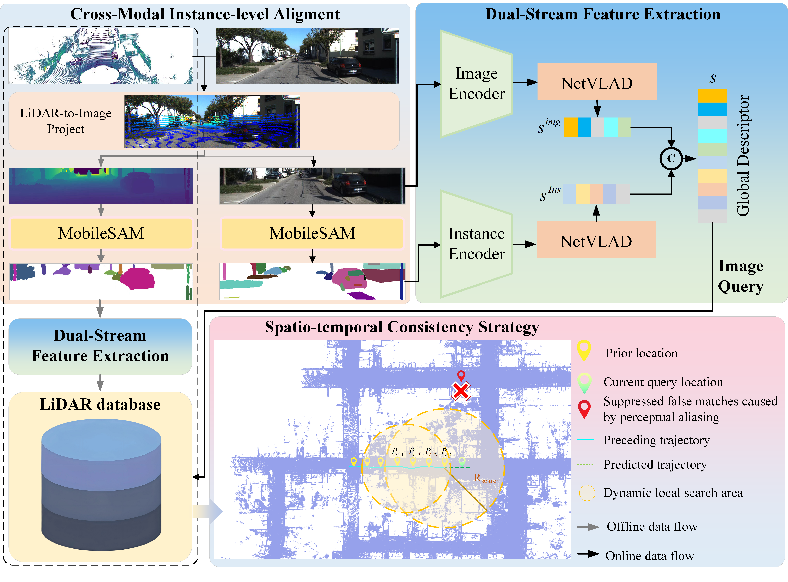

<div align="center">

# LuSeg: Efficient Negative and Positive Obstacles Segmentation via Contrast-Driven Multi-Modal Feature Fusion on the Lunar

</div>
<p align="center">
  <a href="https://github.com/Shuaifeng-Jiao">Shuaifeng Jiao</a>,
  <a href="https://ieeexplore.ieee.org/author/37085664722">Zhiwen Zeng</a>,
  <a href="https://github.com/WangYushan9264">Zhuoqun Su</a>,
  <a href="https://github.com/Chen-Xieyuanli">Xieyuanli Chen</a>
   Zongtan Zhou<sup>*</sup>,
  <a href="https://scholar.google.com.hk/citations?hl=en&user=cp-6u7wAAAAJ">Huimin Lu</a>
 
  
</p>

<p align="center">
  <span style="display: inline-block;">
    <a href="https://arxiv.org/pdf/2503.11409" target='_blank'>
      
    </a>
  </span>
  
  <span style="display: inline-block;">
    <a href="https://drive.google.com/drive/folders/17qlztnZj_POkljKoBVu3Qccu09rBvYwT?usp=sharing" target='_blank'>
      
    </a>
  </span>

  <span style="display: inline-block;">
    <a href="https://drive.google.com/drive/folders/1u5eHiEPSuPZm1nmjdD4iixaATTorBbI8?usp=sharing" target='_blank'>
      
    </a>
  </span>

  <span style="display: inline-block;">
    <a href="https://1drv.ms/v/c/9fa243fc9d6318bd/ERalIxw2JaRPgX6dHvGNDggB-5JHOughIMZkYQ6CgkrQpQ?e=y4zu7J" target='_blank'>
      
    </a>
  </span>
</p>




## Environment

The inspected research environment used PyTorch 2.0.1 + CUDA 11.8,
torchvision 0.15.2, timm 1.0.7, mamba-ssm 1.0.1 and causal-conv1d 1.0.2.
The legacy root requirements (torch 1.13.1) did not describe all current model
dependencies. The following is a setup recipe, **not a certified fresh install**:

```bash
conda create -n stcmpr-hcmc python=3.10
conda activate stcmpr-hcmc
python -m pip install torch==2.0.1 torchvision==0.15.2 --index-url https://download.pytorch.org/whl/cu118
python -m pip install -r requirements.txt
python -m pip install packaging ninja
python -m pip install --no-build-isolation -r requirements-cuda.txt
python tools/check_environment.py
```

## Train HCMC

All commands below run from this directory. Replace the placeholder dataset and
checkpoint paths with your own. `--init-checkpoint` starts a new fine-tuning run;
`--resume` restores an interrupted KITTI run including optimizer and scheduler.

```bash
python train_kitti.py --root /path/to/kitti --train-seq 00 \
  --init-checkpoint weights/cmpr_initialization.pth.tar --output-dir outputs/kitti_hcmc
```

## Evaluate

```bash
python evaluate_kitti.py --root /path/to/kitti --checkpoint weights/kitti_hcmc.pth.tar --seqs 0 2 5 6 8
```
